# Sdf1系列多功能综合插件使用说明

> 当前版本：**3.11**（`plugin.yml`）
> 适用服务端：**Paper 26.x / Minecraft 1.21+**
> 编译环境：**JDK 25**（Maven `release=25`）

## 开源协议

本项目（Sdf1_login 插件，含 Java 端与 PHP 端）采用 **GNU Affero General Public License v3.0（AGPL-3.0）** 授权，协议全文见 [LICENSE](LICENSE)。

- 你可以自由使用、修改、分发本项目。
- **若你把本项目（或其修改版）部署为网络服务对外开放，必须向使用该服务的用户提供完整的对应源代码**（AGPL 第 13 条）。
- 衍生作品必须同样以 AGPL-3.0 授权分发。
- 本项目按「原样」提供，不附带任何担保。

# 特别说明：本插件仅有简中语言版本，如需除简中以外的任何版本，请下载插件源码，自行修改！

---

## 0. 项目定位

Sdf1_login 是一个「大而全」的生存服综合插件：以**登录注册**为核心，向外扩展出经济（债券/积分）、商城与二手交易、领地保护、用户组、传送与家、任务、签到、PVP、工单、公告板、封禁公示、物品 SN 防刷、箱子搬运、Web 面板等一整套生存服基础设施。

项目由两端组成，配套使用：

| 端 | 位置 | 职责 |
| :--- | :--- | :--- |
| **Java 插件** | 本仓库根目录 | 游戏内全部逻辑与权威数据 |
| **PHP Web 端** | 同仓库 `../Web`（或独立部署） | 玩家网页面板、管理后台、收银台、在线充值、正版 OAuth 回调 |

两端通过 `sync.php` 接口 + SQLite 共享队列通信：Java 每 5 秒轮询 Web 端队列，Web 端的购买/充值/领地变更最终由 Java 执行。**Java 是游戏数据的权威源，Web 只做展示与排队。**

---

## 1. 功能介绍

### 1.1 账号与安全

| 功能 | 说明 |
| :--- | :--- |
| 登录 / 注册 | `/reg`、`/login`、`/l`，主密码 + 临时密码双轨验证 |
| 邮箱体系 | 绑定邮箱、邮箱验证码、忘记密码、临时密码邮件 |
| 正版登录 | `/mslogin` 走 Microsoft OAuth，完成正版绑定与自动登录 |
| 二次验证（2FA） | `/2fa` 绑定 TOTP（1Password / Microsoft Authenticator 等），支持恢复代码与控制台强制解绑 |
| IP 限制 | 同 IP 最大账号数、同 IP 转账限制 |
| 登录风控 | 密码连错临时封禁 + 邮件告警；异地登录提醒 |
| 账号审批 | 注册审批支持 AUTO / MANUAL / HYBRID 三种模式 |
| 维护模式 | 独立白名单 `白名单.txt`，支持定时窗口、24 小时硬封顶、OP 绕过 |
| OP 白名单 | 接管原生 OP 名单，白名单外持 OP 会被自动撤销并报警（仅控制台管理） |

### 1.2 经济与奖励

| 功能 | 说明 |
| :--- | :--- |
| 债券系统 | 全服主货币，余额 / 冻结 / 转账 / 流水，独立 `bond.db` |
| 积分系统 | 次货币，通过签到、任务、邀请获得，可在积分商城兑换债券/背包格/经验 |
| CDK 兑换 | 支持本地 CDK 与远程 CDK（配合 sdf1 插件） |
| 每日签到 | 连签倍率、补签、债券盲盒 |
| 新人礼包 | 新玩家分阶段礼包 |
| 邀请奖励 | 邀请码、被邀请人首登奖励、单日上限、阶梯翻倍 |
| 交易记录 | 正常商店 / 二手订单 / 玩家出售偏好独立 `shop_trades.db` |

### 1.3 商城与交易

| 功能 | 说明 |
| :--- | :--- |
| 游戏商人 | `/shop`，分类商品、库存、限购、打包、优惠券 |
| 购物车 | 多件合并结算，支持自助退款 |
| 小票与订单 | 聊天小票 + 成书小票，退款订单自动贴标 |
| 二手商店 | `/shopbuy`，玩家自由上架/下架，平台担保，手续费可配置（卖方出/买方出） |
| 流水打印 | `/printer [玩家]` 导出债券流水，24 小时自动清理 |

### 1.4 世界与玩法

| 功能 | 说明 |
| :--- | :--- |
| 领地系统 | 创建/扩建/删除、权限管理、违禁品没收、PVP/爆炸/交互等开关、GUI 与命令行双入口；原「区域防护」已并入，`/protect` 即领地指令入口 |
| 用户组 | 组定义、领地参数、home 上限、付费加入/续费、称号前缀 |
| 传送 | `/tpa` 系列、`/传送 <领地>`、`/back` 返回记录点 |
| 家系统 | `/sethome`、`/home`、`/homes`、`/delhome` |
| 死亡报告 | 记录死亡点，配合 `/back` 快速返回 |
| PVP | 战神榜、连杀播报、独立竞技场世界、练习测试场 |
| 任务中心 | 时长/行为任务、阶段奖励 |
| 垃圾站 | 定时清理掉落物、顶部血条倒计时、末段 Q 键抢救、保留轮数 |
| 公告板 | 侧边栏计分板轮播公告，支持颜色、链接、翻页 |
| 聊天增强 | 违规域名拦截、敏感词、禁言、英文消息机翻双语展示、控制台署名发言 |
| 箱子搬运 | 精准采集斧拆箱 → 2 秒窗口打包 → 放置自动回填（复刻 Chest Transport 玩法） |
| 铁块电梯 | 踩铁块上下传送 |
| SN 防刷 | 物品唯一序列号，追踪归属/位置/容器，支持报失、注销、补办 |
| 成就防作弊 | 插件给予的药水效果会被标记，靠插件凑齐的 `all_potions` / `all_effects` 成就立即撤销 |

### 1.5 社交与服务

| 功能 | 说明 |
| :--- | :--- |
| 工单系统 | 玩家提交、管理员/服务商处理、图片附件、Markdown 渲染 |
| 服务商 | 游戏内授权、抢单大厅、积分/债券结算 |
| 欢迎仪式 | 注册/登录欢迎广播 |
| Web 面板 | 玩家面板、管理后台（19 模块）、收银台、在线充值、正版验证 |

### 1.6 运维与自愈

| 功能 | 说明 |
| :--- | :--- |
| 自动备份 | 每小时第 0/15/30/45 分准点备份在线玩家背包，跳过未登录/拉黑玩家 |
| 封禁公示 | 读取原版 `banned-players.json`，游戏内轮播 + Web 端同步 |
| 群控黑名单 | `/addblack` 软折磨：禁消费/禁领地/禁容器/清背包（有备份），到期自动恢复 |
| 配置热重载 | `插件设置.txt`、垃圾站、黑名单、公告、二手规则等增量热重载 |
| 模板自愈 | 启动时扫描 jar 内模板，缺文件自动释放，缺配置项自动补齐（改过的值不覆盖） |
| 主线程看门狗 | 主线程卡顿时自动打印线程栈，便于定位卡点 |
| 更新检查 | 多通道检查新版本（Gitea / GitHub / Gitee） |
| JSON 构造器 | `/json` 可视化生成 tellraw / 大标题 / 小标题，接管原版报错 |

---

## 2. 安装说明

### 2.1 环境要求

| 项目 | 要求 |
| :--- | :--- |
| 服务端 | Paper 26.x（API 1.21+）；Spigot 未测试 |
| Java | JDK 25 及以上 |
| 数据库 | SQLite（插件内置 `sqlite-jdbc`，无需额外安装） |
| 可选 | PHP 8.x Web 端（需要网页面板/在线充值时） |

### 2.2 前置与可选插件

| 插件 | 类型 | 作用 |
| :--- | :--- | :--- |
| [CY_beibao](https://git.ypshidifu.cn/youpaishidifu/CY_beibao) | 可选，推荐 | 云背包，积分商城可购买背包容量 |
| [sdf1](https://git.ypshidifu.cn/youpaishidifu/Sdf1_plugin) | 可选，推荐 | 远程 CDK 兑换系统 |
| EssentialsX | **不再支持** | 本插件已移除 Vault 经济依赖，统一使用内置债券系统 |

### 2.3 安装步骤

1. 将 `Sdf1_login.jar` 放入服务端 `plugins/` 目录。
2. 启动服务端，插件会自动生成配置目录 `plugins/Sdf1_login/`。
3. 关闭服务端，按需修改配置文件（至少修改 `插件设置.txt` 中的管理密码）。
4. 重新启动，控制台出现 `[Sdf1_login]启动完毕` 即加载成功。
5. 如需网页端：部署 `Web/` 到 PHP 站点，并让 Java 端与 PHP 端的通信密钥保持一致（见第 6.13 节）。

### 2.4 首次启动必做

| 序号 | 事项 | 位置 |
| :---: | :--- | :--- |
| 1 | 修改管理员面板密码 | `插件设置.txt` → `管理密码` |
| 2 | 确认管理标签 | `插件设置.txt` → `管理标签`（默认 `admin`） |
| 3 | 配置 SMTP（找回密码/告警邮件需要） | `SMTP设置.txt` |
| 4 | 按需开启挂机踢出、垃圾站、维护模式 | `插件设置.txt` / `白名单.txt` |
| 5 | 配置菜单与商品 | `菜单.txt` / `shop/*.md` |
| 6 | Web 端首次部署后立即设置强密码并启用二次验证 | Web 端 `admin_2fa_setup.php` |

> ⚠️ 管理密码、SMTP 密码、Web 通信密钥都属于敏感信息。请勿把填写真实值的配置文件提交到任何公开仓库。

### 2.5 从源码构建

```bash
mvn clean package
```

产物：`target/Sdf1_login.jar`。

---

## 3. 数据目录结构

插件数据目录：`plugins/Sdf1_login/`

```
plugins/Sdf1_login/
├── 消息.txt                  # 全部提示消息
├── 插件设置.txt              # 主配置
├── SMTP设置.txt              # 邮件配置
├── 挂机白名单.txt            # 挂机踢出豁免名单
├── 白名单.txt                # 维护模式（控制段 + 白名单段）
├── 菜单.txt                  # 自定义菜单
├── chat.txt                  # 聊天过滤配置
├── illegal_domains.txt       # 违规域名后缀库
├── radio_config.txt          # 广播/资源包配置
├── login.db                  # 账号、积分、签到、邀请等主库
├── bond.db                   # 债券账本
├── usergroup.db              # 用户组
├── web_sync.db               # Web 同步队列
├── area_effects.db           # 领地效果数据
├── 交易记录/shop_trades.db   # 商店/二手交易订单
├── 任务面板/                 # 任务配置与数据
├── shop/                     # 商品分类 md + 二手交易规则.md
├── ban/                      # 封禁公示规则（md 或 json）
├── black/黑名单.md           # 软折磨黑名单
├── 公告/公告.md              # 公告板内容
├── json解码配置/解码配置.md  # /json 调色板
├── chest/cfg.json            # 箱子搬运开关
├── OP白名单/opwl.json        # OP 白名单
├── 邀请好友赢债券/规则.md    # 邀请奖励配置
├── 区域防护/                 # 领地/区域防护配置与各区域文件
│   └── whitelists/           # 领地白名单（全局 + 各区域）
└── printer/                  # /printer 导出的流水文件
```

> 数据库采用 WAL 模式。备份时请连同 `-wal` / `-shm` 文件一起备份，或先停服再复制。

---

## 4. 配置文件

### 4.1 消息.txt

控制插件全部提示消息。支持 § 颜色代码、`<b>` 加粗、`\n` 与 `<br>` 换行，占位符用 `{xxx}`。修改后执行 `/sdf1_login reload`。

```txt
# ==========================================
#      Sdf1_login 消息配置文件
# ==========================================
# 颜色代码使用 § 符号
#   §0黑色 §1深蓝 §2深绿 §3深青
#   §4深红 §5深紫 §6金色 §7灰色
#   §8深灰 §9蓝色 §a绿色 §b浅蓝
#   §c红色 §d粉色 §e黄色 §f白色
#   §l粗体 §n下划线 §o斜体 §r重置
#
# 占位符用 {xxx} 表示，运行时自动替换
# 支持 <b>粗体</b> 标签
# 支持 \n 或 <br> 换行
# 修改后执行 /sdf1_login reload 重载
# ==========================================

# ---- 登录注册相关 ----
login_timeout=§c登录超时，请重新登录
not_registered=§e您尚未注册，请使用 /reg <密码>
not_logged_in=§e您尚未登录，请使用 /login <密码>
already_registered=§c您已注册过账号
already_logged_in=§c您已登录
reg_success=§a注册成功！欢迎来到服务器
login_success=§a登录成功！
login_failed=§c密码错误，请重试

# ---- 密码相关 ----
password_wrong=§c密码错误
password_changed=§a密码修改成功！
password_format_error=§c密码需6位以上，含大小写字母和数字
password_same=§c新密码不能与旧密码相同
reset_no_email=§c您未绑定邮箱，无法找回密码
reset_sent=§a临时密码已发送到您的邮箱，请查收

# ---- 签到积分相关 ----
checkin_already=§c您今日已签到
checkin_success=§a签到成功！获得 {points} 积分，连续 {streak} 天，倍率 x{multi}
points_insufficient=§c积分不足，当前: {points}
points_purchase_success=§a购买成功！消耗 {count} 积分

# ---- 挂机检测相关 ----
afk_set_enabled=§a挂机检测已开启
afk_set_disabled=§c挂机检测已关闭
afk_kick=§c因挂机过久被踢出

# ---- 邮箱相关 ----
email_set=§a邮箱设置成功：{email}
email_format_error=§c邮箱格式不正确

# ---- 邀请相关 ----
invite_code_generated=§a邀请码：{code}
invite_used=§a邀请成功，邀请人：{player}
invite_self=§c不能使用自己的邀请码
invite_not_found=§c邀请码不存在
invite_referral_bonus=§a邀请奖励！获得 {points} 积分

# ---- 新人礼包相关 ----
gift_not_ready=§c礼包条件未满足
gift_claimed=§a礼包领取成功！

# ---- 审批与IP限制 ----
need_approval=§e注册需审批 (工单#{id})
ip_max_accounts=§cIP注册已达上限

# ---- 管理员操作 ----
admin_delete_confirm=§c请在聊天中输入玩家名确认删除

# ---- 聊天过滤 ----
chat_muted=§c§l[Sdf1_chat] §f你已被禁言，无法聊天
chat_url_blocked=§c§l[Sdf1_chat] §f检测到违规第三方链接: §e{url}
chat_url_violation=§7当前违规次数: §e{count}
chat_url_admin_notify=§e§l[Sdf1_chat] §f{player} 发送违规链接: {url} (第{count}次)
chat_url_broadcast=§c§l[Sdf1_chat] §e{player} §f因发送违规链接被处罚

# ---- 通用 ----
未知参数=§c未知参数或权限不足
# only_player=§c此命令仅玩家可用
```

> 模板会随版本自动补齐新键，你改过的值不会被覆盖。

### 4.2 插件设置.txt

主配置。文件带完整中文注释，直接改值即可；保存后部分键支持增量热重载。

```txt
# ===== Sdf1_login 插件设置 =====
# 管理员的称号标签（拥有该标签的玩家视为管理员）
管理标签=admin
# 游戏内管理员面板密码：请改成你自己的强密码
管理密码=请改成你自己的强密码
# 每个 IP 最多允许注册的账号数
每IP最大账号数=3
# 注册审批模式：AUTO（自动）/ MANUAL（人工）/ HYBRID（混合）
审批模式=manual
# 自动审批延迟（分钟）
自动审批延迟分钟=30
# 未登录踢出时间（秒）
登录超时秒数=60

# ---- 挂机检测 ----
挂机踢出=false
挂机超时秒数=300

# ---- 密码风控 ----
密码错误封禁阈值=5
密码错误封禁时长秒=300

# ---- 垃圾站 ----
垃圾站_启用=true
垃圾站_清理间隔秒=300
垃圾站_保留轮数=1
垃圾站_启发式拦截=true

# ---- 签到奖励 ----
签到固定金额=0
签到最小金额=10
签到最大金额=100
签到给积分=true
签到积分数量=10
补签积分倍率=5
签到债券最小=1
签到债券最大=3
# 奖励发放方式：债券 / 经济（默认债券）
奖励发放方式=债券

# ---- 区域防护 ----
区域防护_管理员模式=tag
区域防护_管理员Tag=admin
区域防护_每平米价格=10
区域防护_最大领地数=3

# ---- 传送 ----
传送_请求有效秒=90
传送_发送间隔秒=10

# ---- 服务商/工单奖励 ----
服务商积分倍率=2.0
基础经济奖励=100
经济奖励每评分=50.0
报单人积分奖励=10
```

### 4.3 SMTP设置.txt

用于邮箱验证码、找回密码、异地登录/2FA 告警。支持 GUI 配置，也可手工修改；重载生效。

```txt
# ===== SMTP 邮件服务器配置 =====
smtp地址=smtp.example.com
smtp端口=465
smtp账号=mail@example.com
smtp密码=请填写你自己的SMTP授权码
发件人名称=Sdf1_login
smtp加密=true
验证码接收邮箱=example@example.com
```

### 4.4 挂机白名单.txt

每行一个玩家名。开启挂机踢出后，名单内玩家不会被踢。

### 4.5 白名单.txt（维护模式）

独立于原版白名单，分「控制段」和「白名单段」。

```txt
# ===== 控制段 =====
启用 = false
开始时间 = 2026-01-01 20:00
结束时间 =
时长 = 24h
OP可绕过 = true
消息 = &c&l[服务器维护] &7服务器正在维护中，请稍后再试（结束时间: &e{结束时间}&7）

# ===== 白名单段 =====
[白名单]
Steve
Alex
```

- 时间支持：10 位秒级时间戳、13 位毫秒时间戳、`yyyy-MM-dd HH:mm`、`2026年9月28日14时30分`、只写 `HH:mm`（今天）。
- 未填结束时间/时长时默认 24 小时；单次维护最长 24 小时，到点自动结束。
- 拦截发生在异步预登录阶段，未授权玩家不会收到任何世界数据包。
- 玩家登录/加入/退出时自动热重载，改完即生效。

### 4.6 chat.txt

聊天过滤与违规域名处罚规则。

```txt
# Sdf1_chat 聊天过滤配置
通知管理员: true
全服通报: true
禁言时长: 300

白名单:
*.minecraft.net
baidu.com
github.com

处罚规则:
1:warn:0
2:warn:0
3:mute:300
5:mute:600
8:kick:0
10:ban:0

白名单玩家:
```

处罚动作：`warn` 警告、`mute` 禁言、`kick` 踢出、`ban` 封禁、`banip` 封禁 IP。

### 4.7 illegal_domains.txt

违规域名后缀库，每行一个。聊天中出现命中后缀的链接会被拦截；`http` 开头及未加白的 IPv4/IPv6 一律拦截。支持热更新。

### 4.8 radio_config.txt

服务器广播/资源包配置。

```txt
# ============ Sdf1 Radio Config ============
# resource-pack-url
#   填外部地址（HTTP 或 HTTPS 均可），留空 = 使用内置 HTTP 服务
# http-port
#   内置 HTTP 端口（仅 resource-pack-url 为空时生效）
# ============ Settings ===============
resource-pack-url=https://example.com/radiopack.zip
http-port=8080
```

- 支持通配符域名；使用通配符时会随机生成 URL。
- 不需要广播功能时，不要在 `plugins/Sdf1_login/radio/ogg/` 放 ogg 文件，服务端就不会生成资源包，也不会强制下载。

### 4.9 菜单.txt

自定义雪球/物品菜单。使用类 JSON 格式，支持 `//`、`#`、`/* */`、`<!--- --->` 注释。

```json
{
  标题：主城传送
  指令：/dom tp 主城区
  权限类型：玩家
  图标：COMPASS
}

{
  标题：游戏商人
  指令：/shop
  权限类型：玩家
  图标：shield
  格子：28
}
```

- `指令` 填 `xxx.txt` 表示进入二级菜单。
- `图标` 填原版 Material 名，大小写不敏感。
- 修改后执行 `/sdf1_login menu reload`。

### 4.10 shop/ 商品与二手交易

**普通商品**：一个 md 文件对应一个分类。

```md
# 建筑材料

| ID | 品名 | 材质 | 购入价 | 售出价 | 库存 | 本小时销量 | 总销量 |
| --- | --- | --- | --- | --- | --- | --- | --- |
| STONE | 石头 | STONE | 10 | -1 | -1 | 0 | 0 |
| OAK_PLANKS | 橡木木板 | OAK_PLANKS | 8 | 3 | -1 | 0 | 0 |
```

- `购入价`：玩家买入价；`售出价`：玩家卖给商店的价格，`-1` 表示商店不收。
- `库存`：`-1` 表示无限。

**二手交易**：`shop/二手交易规则.md`，可配置上架数量、最低售价、手续费比例、手续费支付方（卖方出 / 买方出）、下架理由列表等。支持增量热重载。

### 4.11 ban/规则配置.md（封禁公示）

数据源为原版 `banned-players.json`。支持 md 表格或内嵌 json 配置；也可直接放 `*.json`。

```md
## ----配置区开始----

| 名字 | 功能说明 | 参数值 |
| --- | --- | --- |
| 轮播最低间隔 | 最短多少秒播报一次（建议 60） | 60 |
| 轮播最大间隔 | 最长多少秒播报一次（建议 300 以内） | 180 |
| 播报模式 | 由近到远 / 由远到近；0 表示关闭 | 由近到远 |
| 播报起点 | 插件安装前的历史封禁不播报，填日期如 2026-08-01；0/留空=自动 | 0 |

## ----配置区域结束----
```

### 4.12 black/黑名单.md（软折磨）

```md
### ----配置区域开始----

| 玩家名字 | 拉黑时长 | 理由 |
| --- | --- | --- |
| Steve | 终身 | 违反服务器规则 |
| Alex | 2026-10-20 14:30 | 恶意破坏 |

### ----配置区域结束
```

- 时长：空 / `0` / `终身` / `永久` = 永久；`yyyy-MM-dd HH:mm` = 到该时刻；`yyyy-MM-dd` = 当天 23:59:59；也支持 `30分`、`2小时`、`3天`、`1周` 等相对时长。
- 生效效果：禁止消费债券、禁止登录 Web、禁止创建领地/成为授权玩家、禁止破坏/放置/开容器/拾取/村民交易，背包清空前自动备份，聊天自动附加「我是罪人」签名。
- 新增/删除条目后 5 秒内自动增量重载，到期自动解除并恢复背包与权限。

### 4.13 公告/公告.md（公告板）

```md
## ----公告区域开始----
```json
{
  "开关状态":true,
  "翻页时间":15,
  "1": {
    "msg": "草原探险服务器欢迎您",
    "color": "green"
  },
  "2": {
    "msg": "服务器官方群：981954292",
    "color": "aqua"
  },
  "3":{
    "msg":"最低支持版本：1.21.11",
    "color":"gold"
  },
  "4":{
    "msg":"最大支持版本：26.x",
    "color":"#FF55FF"
  },
  "5":{
    "msg":"服务器ip: mc2.ypshidifu.cn",
    "color":"blue"
  },
  "6":{
    "msg":"端口：30679，Java免输入~"
  }
}
```
## ----公告区域结束----
```

- `color` 支持颜色英文名、`#RRGGBB`、`r=0 g=0 b=0`。
- 未填颜色时继承上一条，全部未填则回退白色。
- `开关状态` 控制显示，`翻页时间` 单位为秒。

### 4.14 json解码配置/解码配置.md

`/json` 构造器的自定义调色板。

```md
## ----配置区域开始----

| 颜色代码 |
| --- |
| red |
| aqua |
| #FF55FF |

## ----配置区域结束----
```

### 4.15 chest/cfg.json（箱子搬运）

```json
{
  "开关": true,
  "是否合并两个箱子": 1,
  "解释说明": {
    "开关": "开启后接管持精准采集斧、且拥有容器管理权限的领地主/成员拆箱",
    "是否合并两个箱子": "2 秒内连续拆两个箱子时，是否合并为一个打包箱"
  }
}
```

支持 `true/false` 与 `0/1` 两种写法；玩家每次拆箱时增量热重载。

### 4.16 OP白名单/opwl.json

接管原生 OP 名单：白名单是 OP 的唯一真相，原生 `ops.json` 只作为存档。白名单外的 OP 会在 15 秒内被撤销并报警；白名单内在线玩家缺 OP 时自动补授。

- 控制台命令：`/opwl add <玩家> [时长]`、`/opwl remove <玩家>`、`/opwl list`。
- 也可直接编辑 `OP白名单/opwl.json`。
- `opwl` 与 `conmsg` 均为控制台专属，玩家侧不可见。

### 4.17 邀请好友赢债券/规则.md

```md
## ----配置区开始----
| 项目 | 解释 | 值 |
| :---: | :---: | :---: |
| 邀请人单次奖励 | 每成功邀请一位好友，邀请人立即获得的债券 | 10 |
| 被邀请人单次奖励 | 被邀请人注册并首次上线后获得的债券 | 5 |
| 单日邀请奖励上限 | 邀请人一天内累计上限，次日重置 | 100 |
| 单日邀请翻倍额度 | 每邀请 X 人，奖金翻 Y 倍 | 每邀请2人，奖金翻1倍 |
## ----配置区域结束----
```

### 4.18 领地/区域防护配置

`区域防护/区域防护配置.txt` 为领地/区域防护的全局配置；每个区域一个 `区域名.txt`，白名单在 `区域防护/whitelists/`。详见 6.4 节。

---

## 5. 指令大全

> 命令名大小写不敏感；标注「管理员」的命令需要管理标签/OP/管理员密码；标注「控制台」的命令只能在服务端控制台执行。

### 5.1 账号与安全

| 指令 | 说明 | 权限 |
| :--- | :--- | :--- |
| `/reg <密码>` / `/注册 <密码>` | 注册账号 | 玩家 |
| `/login <密码>` / `/登录 <密码>` / `/l <密码>` | 登录 | 玩家 |
| `/改密码 <旧密码> <新密码>` | 修改密码 | 玩家 |
| `/设置邮箱 <邮箱>` / `/email <邮箱>` / `/绑定 <邮箱>` | 绑定邮箱 | 玩家 |
| `/找回密码` | 发送临时密码到邮箱 | 玩家 |
| `/2fa add` | 申请绑定 TOTP，获取二维码链接 | 玩家 |
| `/2fa code <6位>` | 完成绑定 / 登录二次验证 / 恢复代码解绑 | 玩家 |
| `/2fa remove <6位>` | 解绑（30 秒内聊天输入 `confirm`） | 玩家 |
| `/2fa remove <玩家> --force` | 强制解绑（30 秒冷静期） | 控制台 |
| `/mslogin` / `/正版` | Microsoft 正版登录 | 玩家 |
| `/web` / `/控制台` | 生成 Web 端登录令牌 | 玩家 |

### 5.2 玩家功能

| 指令 | 说明 |
| :--- | :--- |
| `/玩家信息` | 打开主面板 |
| `/签到` | 每日签到 |
| `/cypay` | 债券：余额 / 转账 / 流水 / 管理 |
| `/shop` / `/商店` | 打开游戏商人 |
| `/shopbuy` | 打开二手交易商店 |
| `/printer [玩家]` | 打印债券流水（管理员可导出全服） |
| `/pvp` | PVP 榜单 / 竞技场 / 练习场 |
| `/recycle` | 打开垃圾回收站 |
| `/公告板` | 刷新/查看公告计分板 |
| `/json` | 打开 JSON 消息构造器 |
| `/update` | 检查插件更新 |

### 5.3 传送与家

| 指令 | 说明 |
| :--- | :--- |
| `/tpa <玩家>` | 请求传送到对方 |
| `/tpahere <玩家>` | 请求对方传送到自己 |
| `/tpaccept` / `/tpdeny` | 接受 / 拒绝传送 |
| `/tpauto` | 自动接受传送 |
| `/tpacancel` | 取消自己发出的传送请求 |
| `/tpaall` | 请求传送到所有在线玩家 |
| `/sethome <名称>` | 设置家 |
| `/delhome <名称>` | 删除家 |
| `/home [名称]` | 传送回家 |
| `/homes` | 列出所有家 |
| `/back` | 返回最近记录点 / 死亡点 |
| `/传送 <领地名>` | 传送到指定领地 |

### 5.4 领地、用户组与保护指令

| 指令 | 说明 |
| :--- | :--- |
| `/group buy <组名>` | 购买用户组 |
| `/group renew <组名>` | 续费用户组 |
| `/group info [组名]` | 查看用户组信息 |
| `/protect` | 领地/区域防护统一入口（帮助 / GUI / CLI） |
| `/landrec give [玩家]` | 领地记录系统（回声碎片发放） |

`/protect` 是领地系统的指令入口（原「区域防护」已并入），支持创建、删除、扩建、收缩、加白、加黑、设置传送点、转让、成员管理、审批等子命令；参数顺序不限，区域名与玩家名可前后互换。

### 5.5 管理与安全

| 指令 | 说明 | 权限 |
| :--- | :--- | :--- |
| `/tempban <玩家/IP> <时长> [理由]` | 临时封禁 | 管理员 |
| `/tempbanip <玩家/IP> <时长> [理由]` | 临时封禁 IP/玩家 | 管理员 |
| `/banip <玩家/IP> [永久] [理由]` | 永久封禁 IP/玩家 | 管理员 |
| `/banget [user\|ip] <目标>` | 点名查询封禁（含历史） | 管理员 |
| `/whois [玩家]` | 查询玩家信息 | 管理员 |
| `/who` | 在线玩家列表 | 管理员 |
| `/addblack <玩家> [时长] [理由]` | 加入软折磨黑名单 | 管理员 |
| `/removeblack <玩家>` | 解除黑名单 | 管理员 |
| `/chat` | 聊天过滤管理 | 管理员 |
| `/垃圾清理` | 手动清理掉落物 | 管理员 |
| `/垃圾抢救` | 紧急取消本轮垃圾站清理 | 管理员 |
| `/清空队列` / `/cleartake` | 清空 Web 同步 pending 队列 | 管理员 |

### 5.6 主命令 `/sdf1_login`

| 子命令 | 说明 |
| :--- | :--- |
| `/sdf1_login reload` | 重载配置 |
| `/sdf1_login del <玩家>` | 删除玩家账号 |
| `/sdf1_login radio` | 停止广播 |
| `/sdf1_login radio reload` | 重载广播并重新打包资源包 |
| `/sdf1_login printer [玩家]` | 同 `/printer` |
| `/sdf1_login shop` | 同 `/shop` |
| `/sdf1_login menu reload` | 重载菜单 |
| `/sdf1_login weblogin` | 同 `/web` |
| `/sdf1_login set packmoney <金额>` | 设置打包费 |
| `/sdf1_login set <玩家> <临时密码>` | 为玩家设置 5 分钟临时密码 |

### 5.7 控制台专属

| 指令 | 说明 |
| :--- | :--- |
| `/conmsg <名字>` | 设置控制台发言署名（默认「管理员」），`/conmsg clear` 恢复 |
| `/opwl add <玩家> [时长]` | 加入 OP 白名单 |
| `/opwl remove <玩家>` | 移出 OP 白名单 |
| `/opwl list` | 查看 OP 白名单 |
| `/2fa remove <玩家> --force` | 强制解绑玩家 2FA |

---

## 6. 核心系统说明

### 6.1 登录与账号安全

**双轨验证**：玩家注册时生成随机的 `password_salt`，密码以 `SHA-256(salt + password)` 存储。登录既接受主密码，也接受管理员下发的临时密码（5 分钟有效、一次性）。

**登录流程**：

1. 玩家进服后处于冻结状态（不能移动/交互/受伤），收到登录提示。
2. 未注册 → `/reg`；已注册 → `/login`。
3. 超时未登录（默认 60 秒）踢出。
4. 同一 IP 在 5 分钟内重连可免密自动登录（可配置）。

**风控**：

- 密码连续错误达到阈值（默认 5 次）→ 临时封禁（默认 300 秒）+ 邮件告警。
- 异地登录 → 向绑定邮箱发送提醒。
- 同 IP 注册账号数超限 → 拒绝注册。
- 被拉黑玩家 → 无法登录 Web、无法创建领地、无法消费。

**2FA**：

- 需要先绑定邮箱。
- `/2fa add` 生成 10 分钟有效的绑定申请与二维码链接。
- 绑定成功后生成 8 组恢复代码发到邮箱；恢复代码可一次性解绑。
- 登录时若 IP 变更或主动验证，会要求输入 6 位动态码。

**正版登录**：

- `/mslogin` 生成 Microsoft OAuth 链接，玩家在浏览器完成授权。
- 回调经 MS token → Xbox → XSTS → Minecraft token → profile，校验通过后自动登录。
- 正版 UUID 与离线 UUID 不一致时，由 `VerificationManager` 做兼容处理。

### 6.2 债券与积分

- **债券**是主货币，存放于 `bond.db`，所有加扣都必须经过 `BondManager`，每笔写流水。
- **积分**存放在 `login.db` 的 `users` 表，主要来源：签到、任务、邀请、工单服务商奖励。
- 积分唯一消费出口是积分商城（兑换债券、云背包容量、经验等），兑换比例由 `PointsManager` 控制。
- 管理员可用 `/cypay give|remove|freeze` 调整债券；所有操作有流水，可用 `/printer` 导出。

### 6.3 商城与二手商店

**普通商店**：

- 商品来自 `shop/*.md`，按文件分分类。
- 支持库存、每小时销量、总销量、限购、打包（潜影盒）、优惠券。
- 结算时校验余额与库存，写订单与小票；发货失败自动退款并贴标。
- 管理员可修改价格/库存，改动会同步到 Web 商城。

**二手商店**：

- 玩家用 `/shopbuy` 上架物品，平台担保。
- 上架数量、最低售价、手续费比例、手续费支付方均可配置。
- 卖家可选择「卖方出手续费」或「买方出手续费」。
- SN 物品与宝箱物品禁止上架。

### 6.4 领地与用户组

- 领地核心为 `AreaProtection`，数据在 `area_effects.db`；命令行入口 `AreaCLIManager`，GUI 入口 `AreaGUIManager`。
- 支持：创建/扩建/收缩/删除、转让、成员与访客、权限细分（PVP、爆炸、火焰、饥饿、摔伤、展示框交互、容器、拾取等）、违禁品没收、领地商店、传送点。
- 用户组（`UserGroupManager`，`usergroup.db`）决定：领地上限、每平米价格、home 上限、效果数量/等级上限、组前缀与颜色、付费加入/续费价格。
- 领地是**权威数据源**：Web 端的领地改动只写队列，由 Java 执行后回推最终状态。
- 原「区域防护」已合并进领地系统，`/protect` 直接复用原区保指令；完整的 `/protect` 参数、区域配置文件写法与生物属性对照表见第 7 节。

### 6.5 垃圾站

- 定时清理地图上的掉落物，默认每 300 秒一轮。
- 顶部血条显示倒计时，临近清理变黄/变红。
- 最后阶段按 Q 丢弃可触发「抢救」，或管理员执行 `/垃圾抢救` 取消本轮。
- `垃圾站_保留轮数=N` 表示每 N 轮真正倒一次垃圾，其余轮次只提示。
- `垃圾站_启发式拦截` 关闭后不再做红区 title 警告与双击 Q 拦截，但血条仍显示。

### 6.6 封禁公示与黑名单

**封禁公示（耻辱台）**：

- 数据源是原版 `banned-players.json`，不是 Bukkit 内存名单（避免重启/Web 改写后不一致）。
- 按配置的间隔轮播被封禁玩家、理由与时间。
- 支持「由近到远 / 由远到近」、播报起点、关闭播报。
- 玩家进服时也会收到一条插播。

**软折磨黑名单**：

- 通过 `/addblack` 或直接编辑 `black/黑名单.md` 添加。
- 被拉黑玩家：不能消费债券、不能登录 Web、不能创建领地、不能成为授权玩家、不能破坏/放置/开容器/拾取/村民交易，背包清空前备份。
- 聊天正常，但每条消息会被追加「我是罪人」签名。
- 到期自动解除并恢复背包与权限；删除条目 5 秒内恢复。

### 6.7 SN 物品防刷

- 每件受管物品带唯一 SN，记录：物品类型、归属、状态、位置（玩家/容器/世界坐标）、所在领地、最后出现时间、报失次数等。
- Java 端为权威源，定时把目录、日志、库存、手持快照推送到 Web 端。
- 支持：报失、注销、补办、永久绑定、管理员强制操作。
- Web 端的操作写入 `web_sn_commands` 队列，由 Java 执行并回写结果。
- 注销后进入冷静期（默认 1 小时），期间禁止申领。

### 6.8 箱子搬运

- 触发条件：领地主/授权成员/管理员，手持带**精准采集**的斧头，拆除领地内的箱子。
- 首拆后挂起 2 秒观察：2 秒内再拆一个箱子 → 成组，两个箱子各交付一个打包箱；超时 → 只处理被拆的那一个。
- 打包箱放置后自动回填物品；双箱会按 54 格处理。
- 非授权玩家拆箱仍交还原版（物品散落，且领地可禁止拾取）。
- 开关与「是否合并两个箱子」在 `chest/cfg.json`。

### 6.9 JSON 消息构造器

- `/json` 打开 27 格面板，支持三种模式：tellraw 原生 JSON、大标题、小标题。
- 颜色行支持自定义颜色与调色板（`json解码配置/解码配置.md`）。
- 文字在聊天栏输入，发送时以玩家身份执行原版指令，天然受原版权限约束。
- 原版 `title` / `tellraw` 报错时，插件会接管报错并直接打开构造器。

### 6.10 公告板

- 侧边栏计分板轮播 `公告/公告.md` 的内容。
- 支持开关、翻页时间、颜色继承、15 字截断换行、可点击链接。
- 与 PVP 侧边栏共存；切换世界后自动重刷。

### 6.11 工单与服务商

- 玩家在面板提交工单，支持 Markdown 与图片附件。
- 状态：已提交 → 已回复 → 已完结 / 已撤销。
- 管理员可分配、驳回、完结；服务商可抢单。
- 服务商由管理员在游戏内工单管理面板授权，奖励按 `服务商积分倍率` 结算。

### 6.12 聊天增强

- 违规域名：按 `illegal_domains.txt` 后缀匹配，`http` 开头与未加白 IP 一律拦截；命中后按 `chat.txt` 梯度处罚。
- 敏感词、广告机检测、禁言（持久化到 `users.muted_until`）。
- 英文消息自动机器翻译，并以双语形式展示（原文由 MC 正常处理，翻译在原文后追加）。
- 控制台发言可用 `/conmsg` 设置署名，未匹配到指令的控制台文本会作为聊天广播。

### 6.13 Web 端联动

- Java 端 `WebManager` 负责：Token、商城同步、CDK 验证、余额、注册同步、领地/用户组/封禁同步、登录请求轮询。
- **通信密钥必须与 Web 端 `config.php` 的 `SECRET_KEY` 完全一致**，否则所有同步接口返回 401。
- 相关配置写在 `插件设置.txt`：`web通信-启用`、`web通信-地址`、`web通信-密钥`、`web通信-同步间隔分钟`、`web通信-Token有效期秒`、`web通信-回调端口`。修改后会自动热重载，无需重启。
- 同步方向：
  - Java → PHP：商品、债券、流水、登录、在线玩家、领地、权限、用户组、封禁、SN 等。
  - PHP → Java：通过 `web_transactions`、`sync_requests`、`web_admin_changes` 等队列，Java 每 5 秒轮询消费。
- Web 端部署与配置详见 `Web/readme.md`；通信细节详见 `Web/代码关联关系.md`。
- 首次部署 Web 端后，请立即访问 `admin_2fa_setup.php` 设置强密码、IP 白名单与二次验证。

### 6.14 运维与自愈

- **自动备份**：每小时第 0/15/30/45 分准点备份在线且已登录玩家的背包，跳过拉黑玩家；备份可用于登录自愈与手动恢复。
- **模板自愈**：启动时扫描 jar 内所有模板；数据目录缺文件则释放，缺配置项则先备份 `.bak` 再补齐，用户改过的值原样保留。
- **主线程看门狗**：主线程静默超过阈值时自动打印线程栈，便于定位卡顿。
- **更新检查**：启动时异步检查 Gitea / GitHub / Gitee，可在配置中关闭。
- **维护模式**：见 4.5；到点自动结束，无需重启。
- **OP 白名单**：见 4.16；原生 `/op` 会被引导到 `/opwl add`。

---

## 7. 领地保护指令（原区域防护）

> 区域防护已合并进领地系统，`/protect` 直接复用原区保指令。本节保留该指令的完整参数、区域配置文件写法与生物属性对照表，作为领地保护的详细参考。

区域保护用于保护主城、展示区、活动场地等不希望被破坏/交互/袭扰的区域。

| 指令 | 参数 1 | 参数 2 | 参数 3 | 结果 |
| :---: | :---: | :---: | :---: | :--- |
| protect | 无 | 无 | 无 | 帮助信息 |
| protect | add | 区域名 | 玩家名 | 加白指定玩家到区域 |
| protect | add | 玩家名 | 无 | 加白指定玩家为全局 |
| protect | additem | 区域名 | 物品名 | 加黑指定物品到区域 |
| protect | additem | 物品名 | 无 | 加黑指定物品到全局 |
| protect | addname | 区域名 | 名字 | 加白指定生物名字到区域和平模式白名单 |
| protect | addplayer | 区域名 | 玩家名 | 加白指定玩家到区域强制模式豁免名单 |
| protect | remove | 玩家名 | 无 | 移除玩家全局白名单 |
| protect | remove | 区域名 | 玩家名 | 移除玩家区域白名单 |
| protect | removeitem | 物品名 | 无 | 删除全局黑名单物品 |
| protect | removeitem | 区域名 | 物品名 | 删除区域黑名单物品 |
| protect | removename | 区域名 | 名字 | 删除区域和平模式白名单 |
| protect | removeplayer | 区域名 | 名字 | 删除区域强制模式豁免名单 |

示例：

- `/protect add 末地保护区 players` 添加 players 到末地保护区
- `/protect removeitem 主城区 TNT` 从主城删除 TNT 黑名单
- `/protect 筑城区 addwhite zhangsan` 把 zhangsan 加白到筑城区

所有参数**任意排序**，区域名与玩家名可前后互换，插件会自动识别。

| 参数 | 效果 |
| :---: | :--- |
| 和平模式 | 所有敌对生物全部进虚空 |
| 禁止袭击 | 清除玩家身上的袭击效果，灾厄村民进虚空 |
| 清除XX效果 | 立即清除玩家身上的效果 |
| 给与XX效果 | 按配置给予指定等级、时长的效果 |

区域配置文件支持 `//`、`#`、`/* */`、`<!--- --->` 注释：

```txt
# 区域: 主城区
起点: world,-130,-713
终点: world,-427,-560
高度范围: 0-255

没收物品: 蘑菇,毒蘑菇
禁止PVP
禁止摔伤
禁止饥饿
禁止一切伤害
// 和平模式
禁止袭击
禁止交互展示框
// 清除所有效果
效果 村庄英雄 255 999999
禁止爆炸
禁止使用物品: TNT
进入提示: 欢迎来到保护区
离开提示: 已离开保护区
没收提示: 你的违禁品已被没收
通报批评: §c§l{player} §f在{area}违规携带违禁品，被没收 §e{count}§f件！
# 惩罚命令: ban {player} 60s 违规
```

### 生物属性对照表

| 中文名称 | 类型 | 附加属性 |
| :---: | :----: | :----: |
| 溺尸 | 近战/远程 | 亡灵、水生 |
| 骷髅 | 远程 | 亡灵 |
| 流浪者 | 远程 | 亡灵、寒冷群系变种 |
| 沼骸 | 远程 | 亡灵、沼泽变种 |
| 焦骸 | 远程 | 亡灵、沙漠变种、免疫阳光 |
| 掠夺者 | 远程 | 灾厄村民、袭击成员 |
| 卫道士 | 近战 | 灾厄村民、袭击成员 |
| 幻术师 | 远程 | 灾厄村民、Java 专属、隐身分身 |
| 旋风人 | 远程 | 试炼密室生成、免疫弹射物、强击退 |
| 监守者 | 近战/声波远程 | 深暗之域、附带盲视效果 |
| 远古守卫者 | 近战/激光远程 | 海底神殿、水下、附加挖掘疲劳 |
| 守卫者 | 近战/激光远程 | 海底神殿、水下 |

---

## 8. 自定义菜单

1. 打开主界面，选择「我的」进入。
2. 将自定义物品与雪球交换。
3. 系统会重新发放菜单，此时图标就是你自定义的物品。

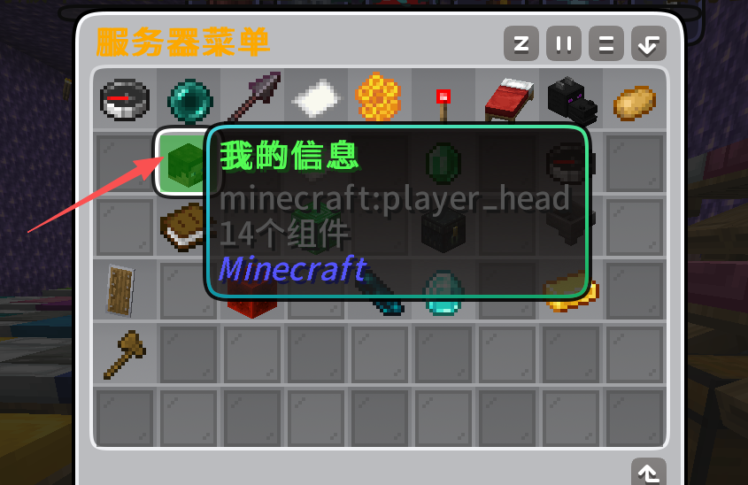
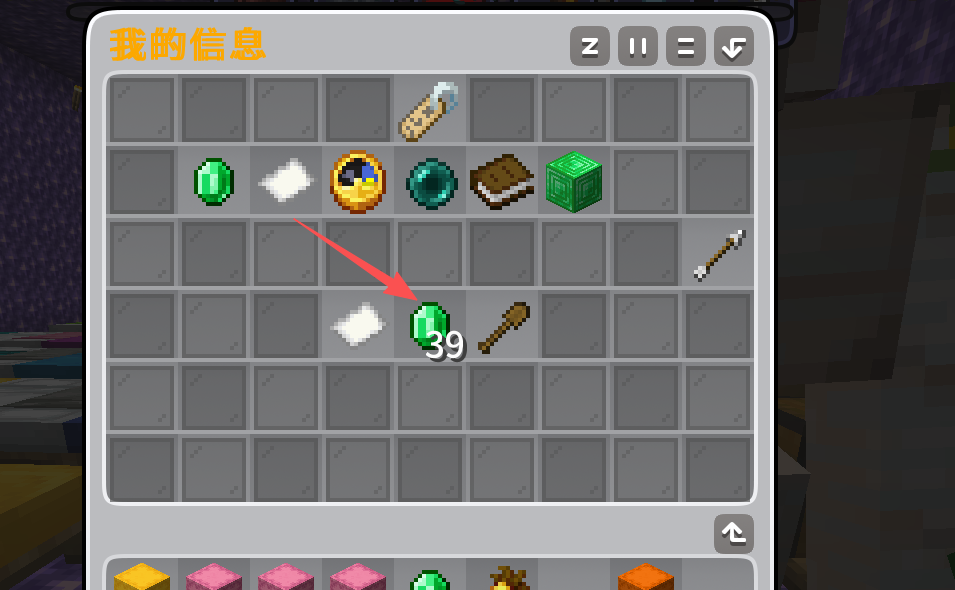

菜单内容由 `菜单.txt` 控制，支持多级菜单、格子位置、权限类型。修改后执行 `/sdf1_login menu reload`。

---

## 9. PVP 战神榜

- 可在服务器内制作击杀排行榜，并精准定位指定区域。
- 击杀通报逻辑：3 杀、5 杀、5 杀以上每杀一次播报；触发连杀的玩家被终结也会有全服通报。
- 支持独立竞技场世界与练习测试场（`/pvp join`、`/pvp leave`、观赛模式）。

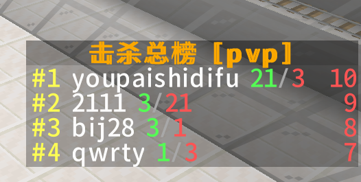


---

## 10. 商城与流水

### 10.1 商城

- 自助退款：买多买错可单件退单。
- 购物车：先加购，统一结算。
- 历史订单：一键查看。
- 退款订单自动贴标，防止「白嫖」。
- 管理员可查看玩家消费记录。

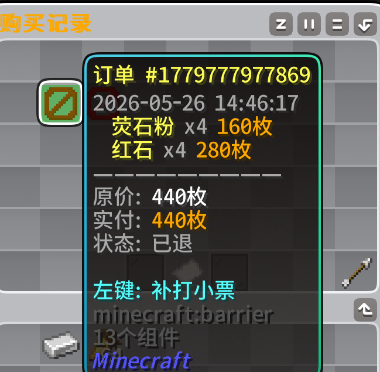
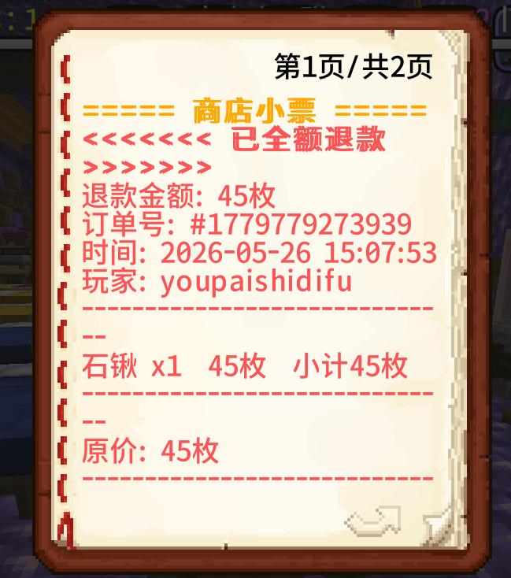
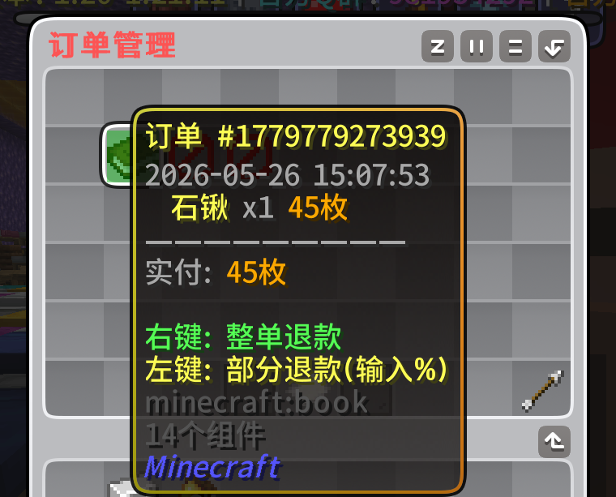
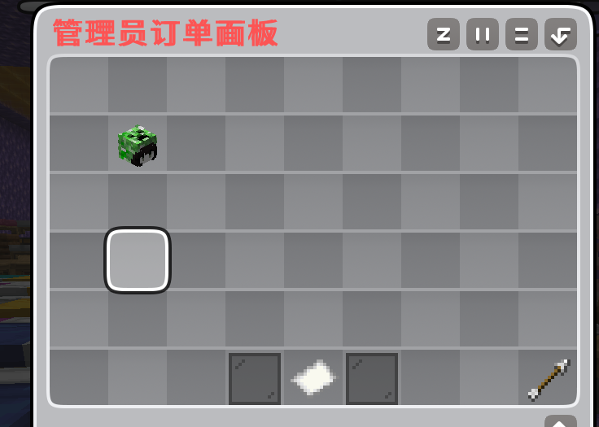

### 10.2 打印流水

- `/printer <玩家>` 导出单个玩家流水；`/printer` 导出全服流水。
- 文件输出到 `plugins/Sdf1_login/printer/`。
- 插件每小时检测一次，超过 24 小时的旧文件自动删除。

---

## 11. 常见问题

**Q：启动后提示「数据库被锁定 / database is locked」？**
A：确认没有多个服务端实例同时使用同一数据目录；不要把 `plugins/Sdf1_login` 放在网络盘/NFS 上；备份时先停服。

**Q：玩家登录后仍然不能动？**
A：检查是否被拉黑、是否处于维护模式、是否未完成 2FA 验证；查看控制台是否有风控/黑名单日志。

**Q：修改了配置但不生效？**
A：多数配置支持 `/sdf1_login reload` 或增量热重载；`插件设置.txt` 的部分键、垃圾站、黑名单、公告、二手规则会在运行中自动检测。数据库结构变更需要重启。

**Q：Web 端所有接口返回 401？**
A：Java 端与 Web 端的通信密钥不一致。检查 `插件设置.txt` 中的 `web通信-密钥` 与 `Web/config.php` 的 `SECRET_KEY` 是否一字不差；同时确认 `web通信-启用=true`、`web通信-地址` 指向正确的站点目录。

**Q：玩家收不到找回密码邮件？**
A：检查 `SMTP设置.txt` 的服务器、端口、账号、授权码与加密方式；部分邮箱需要使用「授权码」而不是登录密码。

**Q：资源包一直强制下载 / 玩家拒绝后被踢？**
A：确认 `radio/ogg/` 下是否有 ogg 文件；不需要广播时清空该目录。检查 `radio_config.txt` 的 `resource-pack-url` 是否可访问。

**Q：如何彻底卸载？**
A：停服后删除 `plugins/Sdf1_login/` 与 `plugins/Sdf1_login.jar`。如需保留数据，先备份整个目录（含 WAL/SHM 文件）。

---

## 12. 运行截图

主界面

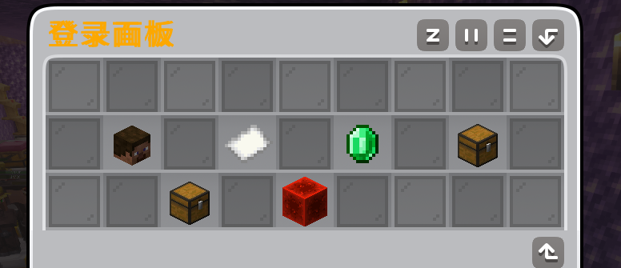

邀请数据

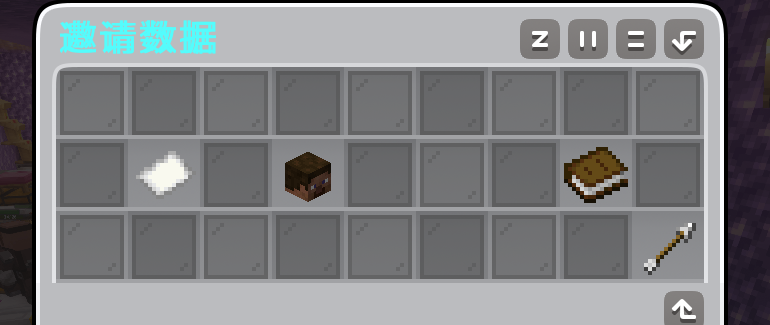

积分商店

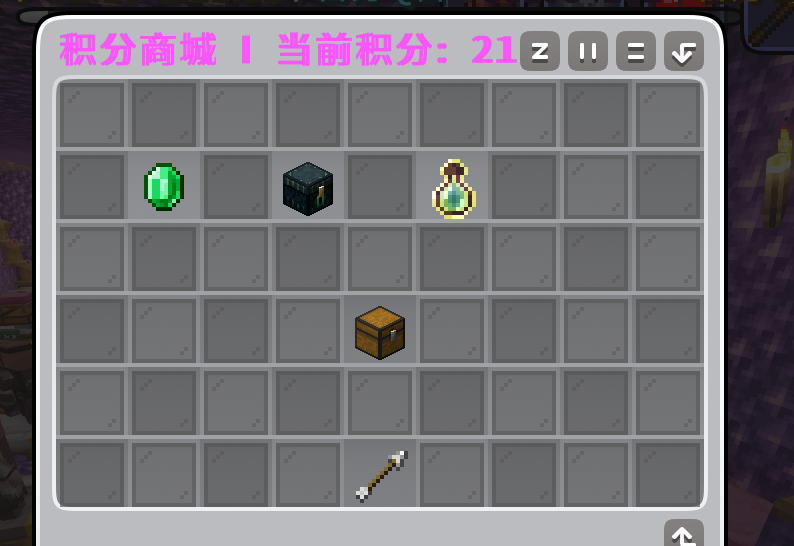

任务中心

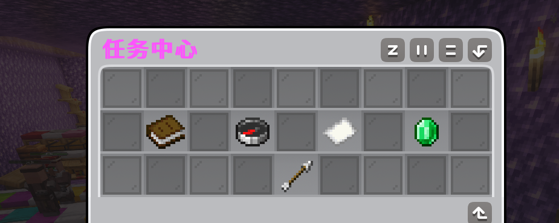

垃圾箱

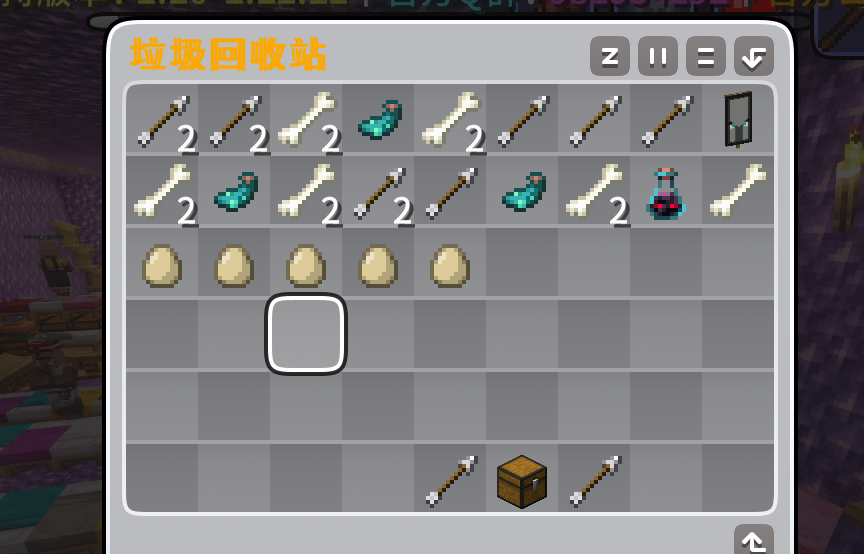

管理员面板

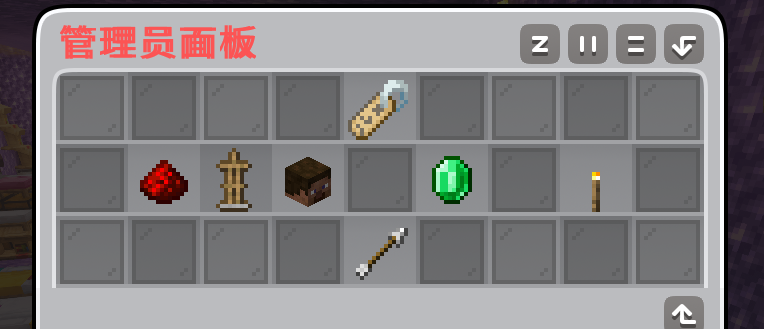

管理面板 - 用户管理

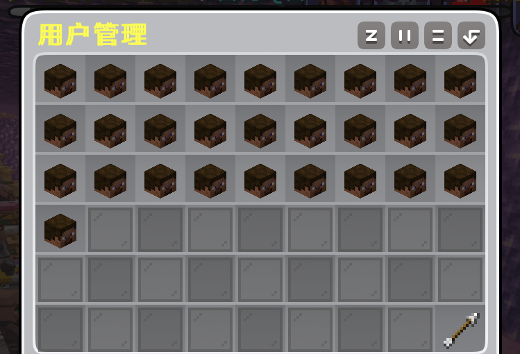

工单中心

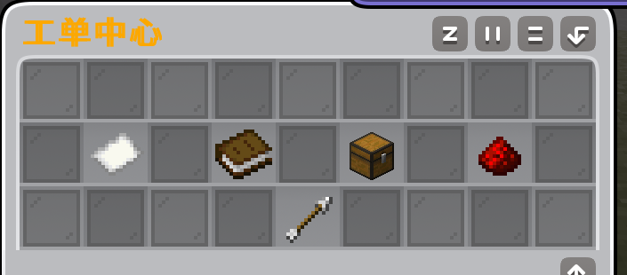

工单管理

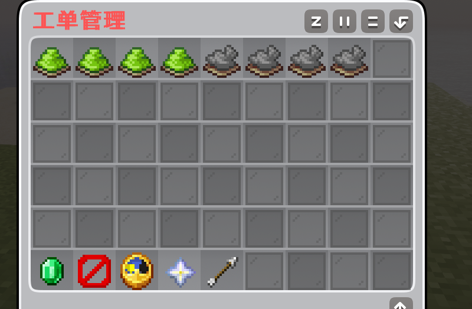

我的工单

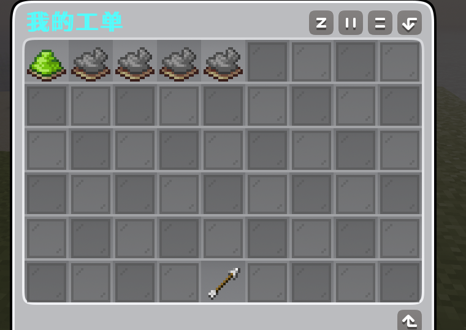

提交工单

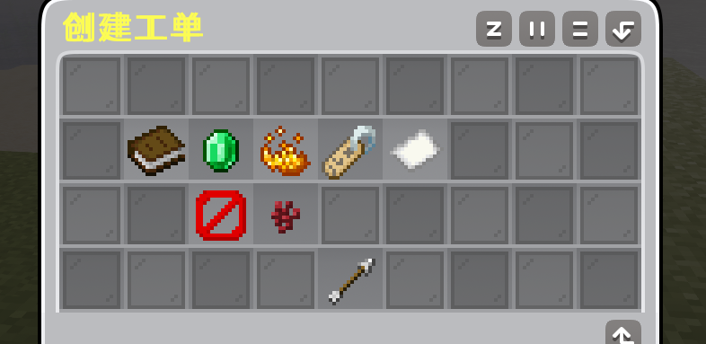

服务商列表


服务商抢单大厅

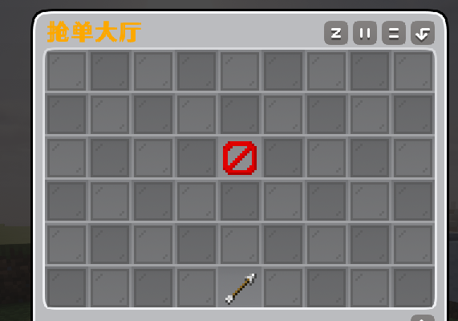

服务商 - 接单界面

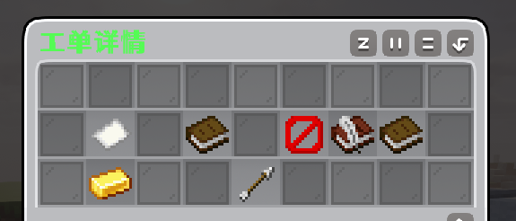

管理员 - 工单详情

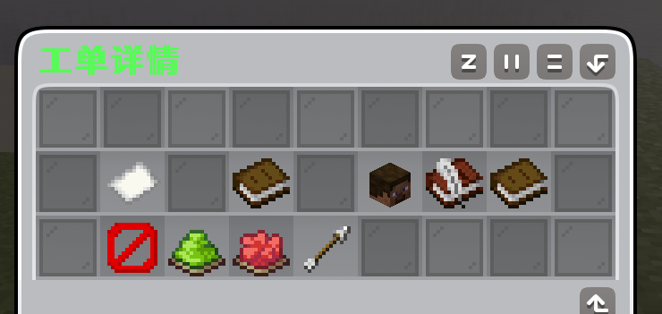

商城主界面

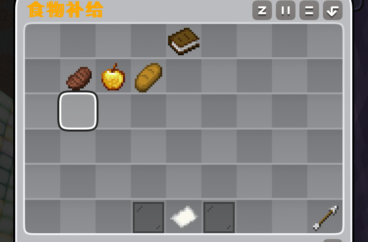

商城购物车


商城退单

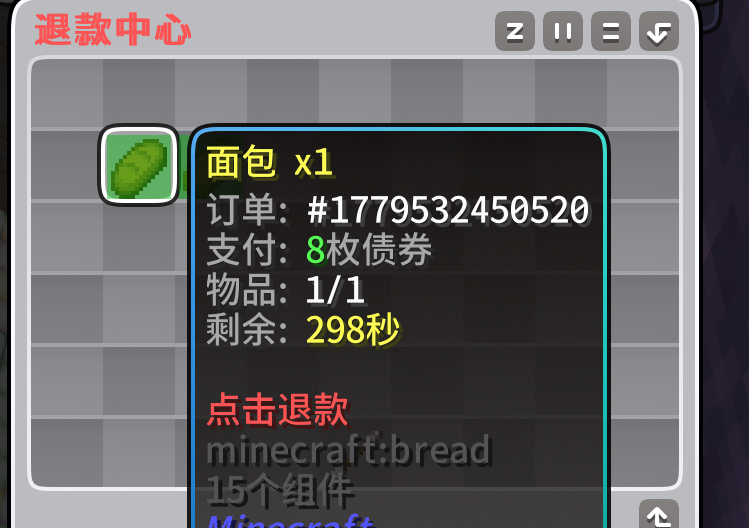

---

## 13. 版本更新摘要（3.1）

### 3.1

- 修复注册/最近登录时间变成 1970 年的问题。
- 域名过滤改为按 `illegal_domains.txt` 后缀判定，修复「你好.今天天不错啊」误伤。
- 修复垃圾箱保留轮次、开关热重载、展示框交互拦截。
- 新增二手商店、违禁品没收、领地村民交易权限、英文聊天机翻、领地增益效果联控用户组、控制台消息接管、准点自动备份、垃圾站软提醒、封禁常态化公示、箱子搬运、JSON 可视化面板。

---

## 14. 下载地址

- 官方文档：[https://wiki.ypshidifu.cn](https://wiki.ypshidifu.cn)（推荐）
- GitHub：[https://github.com/ypsdf1/sdf1_login](https://github.com/ypsdf1/sdf1_login)
- Gitee：[https://gitee.com/nihaoshidifu/sdf1_login](https://gitee.com/nihaoshidifu/sdf1_login)
- gitcode：[https://gitcode.com/ypsdf1/Sdf1_login](https://gitcode.com/ypsdf1/Sdf1_login)

---

*本文档适用于 Sdf1_login 3.11。若你修改了插件源码，请同步更新本文与实际行为不一致的部分。*
